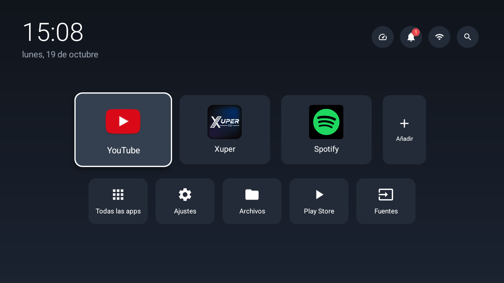

# MYO Launcher

A minimal, ad-free home screen for cheap Android TVs, built for a MYO TV (HiSilicon Hi3751V350, Android 14, 1 GB RAM) that ships with an ad-filled Zeasn launcher.



## Features

- Big clock and date
- Main row of favorite apps (default: YouTube, Xuper, Spotify). Hold OK on a tile to move it or remove it, or use **+ Añadir** to add more
- Utility row: all apps, Android settings, files, Play Store, input sources
- Top bar: resources (CPU / RAM / storage, measured only while that screen is open), notifications (this TV has no SystemUI, so the launcher shows them itself), Wi-Fi, and text search across apps and files on internal storage and USB drives
- Works with the D-pad and with air-mouse remotes (tiles highlight on hover)
- English or Spanish, following the system language

No dependencies and no Gradle. It's plain Java with programmatic views, built with the SDK tools directly.

## Build

Requires the Android SDK (`build-tools/36.0.0`, `platforms/android-34`), JDK 17+, and `~/.android/debug.keystore`.

```sh
./build.sh            # -> build/simplehome.apk
```

## Install on the TV

1. Enable ADB. On MYO / Cultraview TVs, press **Source** on the remote and enter **2580** to open the factory menu, turn on ADB, and power-cycle the TV.
2. Connect and install:

```sh
adb connect <TV_IP>:5555
adb install -r build/simplehome.apk
adb shell cmd package set-home-activity com.faustino.simplehome/.HomeActivity
adb shell cmd notification allow_listener com.faustino.simplehome/com.faustino.simplehome.NotificationService
adb shell appops set com.faustino.simplehome MANAGE_EXTERNAL_STORAGE allow   # file search
```

## Custom background (optional)

Push any 1280×720 JPEG. It's a good idea to blur and darken it first so the tiles stay readable. It isn't part of the repo, so personal photos stay on the TV:

```sh
convert photo.jpg -resize 1280x720^ -gravity center -extent 1280x720 \
  -blur 0x8 -fill black -colorize 30% background.jpg
adb push background.jpg /sdcard/Android/data/com.faustino.simplehome/files/background.jpg
```

Without it, the screens use a dark gradient.

## Debloat (optional)

These packages were removed from this TV:

```sh
# Stock launcher, its app store, ad provider, retail demo
for p in com.zeasn.launcher zeasn.open.technical.tv.store \
         com.zeasn.deviceportal.asdprovider.cetus.pub com.cultraview.retail; do
  adb shell pm disable-user --user 0 $p
done

# Seraphic "SAD-APK": floating video ads over the home screen plus a key-intercepting
# accessibility service. It's a persistent system app that keeps running even when
# disabled, so uninstall it for the user instead.
adb shell pm uninstall -k --user 0 com.sraf.launcher.ext
```

Hide Android Settings sections that don't apply to a TV (needs `adb root`, which works on this userdebug build). Fabricated overlays and component changes survive reboots:

```sh
adb root
for b in top_level_battery top_level_connected_devices emergency_settings emergency_gesture_settings; do
  adb shell cmd overlay fabricate --target com.android.settings --name hide_$b \
    com.android.settings:bool/config_show_$b 0x12 0
  adb shell cmd overlay enable com.android.shell:hide_$b
done
adb shell 'pm disable com.android.settings/.Settings\$WallpaperSettingsActivity'   # "Wallpaper" entry
# Nobody can set a screen-lock PIN: with no SystemUI there is no lock screen to type it into,
# so a PIN would leave the TV unusable after a reboot.
adb shell cmd overlay fabricate --target com.android.settings --name hide_unlock_set_or_change \
  com.android.settings:bool/config_show_unlock_set_or_change 0x12 0
adb shell cmd overlay enable com.android.shell:hide_unlock_set_or_change
adb shell pm disable com.android.settings/.password.SetNewPasswordActivity
adb shell device_config set_sync_disabled_for_tests persistent
adb shell device_config put privacy safety_center_is_enabled false   # its "set up screen lock" card
adb unroot
```

Everything above can be undone with `pm enable <pkg>`, `cmd package install-existing <pkg>`, or `cmd overlay disable com.android.shell:<name>`.

## Notes

- **Bluetooth:** this model has no Bluetooth chip (only a USB Wi-Fi module), even though Android claims support for it. Turning it off stops the Bluetooth stack from crash-looping at boot: `adb shell cmd bluetooth_manager disable`.
- **Screen mirroring:** Samsung Smart View works through the built-in `com.hisilicon.miracast` app. While mirroring, the TV leaves your home Wi-Fi, because the chip can't do Wi-Fi Direct and a normal Wi-Fi connection at the same time.
